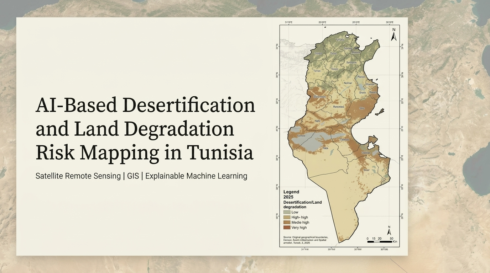

# Tunisia Desertification Risk Mapping

<p align="center">
  
</p>

**An end-to-end geospatial machine learning pipeline that maps and forecasts desertification risk across Tunisia (2016–2030) from satellite and climate data, with no field-verified ground truth required.**

Built as a layer of **SmartSDG Tunisia**, supporting **SDG 15.3** (Land Degradation Neutrality) and **SDG 13** (Climate Action).
Internship project, Manouba School of Engineering (Ecological Engineering), 2025–2026, by **Amal Herch**, supervised by **Ali Ben Abbes**.

Full results and tables: [`RESULTS.md`](./RESULTS.md)

---

## TL;DR

| | |
|---|---|
| **Problem** | No national, field-verified desertification dataset exists for Tunisia, so supervised learning has no obvious label. |
| **Approach** | Build a defensible proxy label (AHP-weighted Desertification Risk Index, classified with Jenks Natural Breaks), then train and rigorously validate ML models on top of it. |
| **Data** | Sentinel-2 (NDVI, SAVI, BSI) + CHIRPS rainfall + ERA5-Land temperature, harmonised on a shared 5 km national grid, 2016–2025. |
| **Final model** | XGBoost, 98.6% accuracy / 98.2% balanced accuracy on a held-out time split, chosen via SHAP-verified ecological behaviour rather than raw accuracy. |
| **Forecast** | High-risk land projected to rise from **63.0% (2025) to 69.0% (2030)**, driven by erosion of the Medium-risk transition zone in central Tunisia. |
| **Delivery** | Interactive dashboard: risk map (cell or governorate level, 2018–2030), governorate explorer, trends and forecast, methodology. |

---

## Pipeline

```mermaid
flowchart LR
    A[Satellite + climate data<br/>Sentinel-2 · CHIRPS · ERA5-Land] --> B[Cleaning & QA<br/>5 km grid, 2016–2025]
    B --> C[EDA · VIF · temporal<br/>& spatial analysis]
    C --> D[Feature engineering<br/>trends · anomalies · rolling]
    D --> E[Proxy label<br/>AHP DRI → Jenks classes]
    E --> F[Model comparison<br/>RF · XGBoost · LogReg]
    F --> G[Validation<br/>temporal · rolling · spatial block]
    G --> H[SHAP<br/>explainability]
    H --> I[Forecast 2026–2030<br/>+ out-of-time backtest]
    I --> J[Dashboard]
```



---

## Steps in detail

### 1. Data preparation and quality control
- Loaded the multi-source GeoPackage (grid cells × years) with **GeoPandas**; removed redundant ID/export columns and duplicate records.
- Imputed missing environmental values (median), enforced correct dtypes, and dropped rows with missing year or geometry.
- **Geometry validation:** repaired invalid polygons (`buffer(0)`), removed empty geometries, and checked CRS consistency.
- **Physical range checks:** NDVI/SAVI/BSI within [−1, 1], rainfall ≥ 0, temperature within plausible bounds.
- **Water/wetland masking:** excluded cells with `water_fraction ≥ 0.3` so lakes and salt-lake surfaces are not misread as desert, with a **threshold sensitivity check** (0.1 / 0.2 / 0.3 / 0.5).

### 2. Exploratory analysis
- Distributions and bivariate relationships (NDVI vs rainfall, NDVI vs temperature, BSI vs NDVI, BSI vs temperature).
- Correlation heatmap and **Variance Inflation Factor (VIF)**: NDVI and SAVI were near-collinear, so **SAVI was dropped** to avoid redundant signal.
- **Temporal analysis** (national yearly means 2016–2025) and **spatial analysis** (governorate-level means, confirming the expected south-arid / north-humid gradient).

### 3. Feature engineering (leakage-aware)
Built per-cell temporal features using **backward-looking windows only**, so no future information leaks into any row:
- Year-over-year change in NDVI, BSI, rainfall, temperature
- 2-year trailing rolling means (`shift(1)` before the rolling window)
- 2-year backward **NDVI slope** (`scipy.stats.linregress`)
- NDVI and rainfall **anomalies** relative to the trailing mean
- Cell centroid latitude/longitude

### 4. Label construction: Desertification Risk Index (DRI)
Because no ground truth exists, the label is built from domain knowledge:
- Inputs are **standardised (z-scores)** and combined with **Analytic Hierarchy Process (AHP)** expert weights: NDVI 30%, BSI 25%, rainfall 15%, temperature 15%, NDVI trend 15%, each with the ecologically correct sign (low vegetation and rainfall raise risk; high bare soil and heat raise risk).
- Continuous DRI is classified into **Low / Medium / High** with **Jenks Natural Breaks** (data-driven, variance-minimising class boundaries).
- **Sanity checks:** DRI vs NDVI-trend correlation, and share of High-risk cells with a declining NDVI trend.
- **Weight robustness analysis:** class stability under equal weights, vegetation-heavy, climate-heavy, no-trend, and 300 random Dirichlet-sampled weight vectors.

### 5. Modelling and model selection
- **Time-based split:** train on ≤ 2023, test on 2024–2025 (no random shuffling across time).
- Compared **Random Forest**, **XGBoost** (class-weighted via balanced sample weights), and **Logistic Regression** (scaled features).
- Metrics: accuracy, balanced accuracy, macro precision/recall/F1, confusion matrices, 5-fold CV, one-vs-rest macro **AUC**, and **calibration curve** for the High-risk class.
- **Selection logic:** Logistic Regression scored slightly higher, but because the label is a (near-)linear formula of the inputs, that mostly reflects reconstructing the DRI. **SHAP** showed XGBoost learns non-linear ecological thresholds, so it was selected for ecological validity rather than headline accuracy.

### 6. Validation (four independent angles)
| Scheme | What it tests | Result |
|---|---|---|
| Held-out temporal split (2024–2025) | Generalisation to unseen years | 98.6% acc. / 98.2% bal. acc. |
| 2025 real vs predicted | Agreement on the latest year | 98.4% |
| Rolling-origin CV (expanding window) | Stability across forecast origins | 97.6% mean acc. |
| Spatial block CV (leave-one-governorate-out) | Transfer to regions never seen in training | 97.4% mean acc. |

### 7. Explainability
- **SHAP (TreeExplainer)** for the High-risk class: global bar chart, beeswarm, and dependence plots for NDVI, rainfall and BSI.
- **Per-variable SHAP maps** showing *why* a cell is risky, not only *where*.

### 8. Forecasting 2026–2030
- **Stage A:** per-cell linear extrapolation of NDVI, BSI, rainfall and temperature, clipped to physical bounds.
- **Stage B:** rebuild all engineered features on the combined real + forecast series.
- **Stage C:** classify forecast years with the trained model; quantify **prediction uncertainty** for 2030 and map where risk worsens.
- **Out-of-time backtest:** forecast 2022–2025 using only 2018–2021, then compare to known outcomes: **84.7% classification agreement**. This tests the forecasting method itself, not just the classifier.

### 9. Delivery
Exports to GPKG / GeoJSON / Shapefile for QGIS, plus an interactive dashboard (Risk Map, Governorate Explorer, Trends & Forecast, Methodology).

---

## Key findings
- Risk follows a clear **north-to-south gradient**; southern governorates (e.g. Tataouine, Kébili, Tozeur) show the lowest vegetation and highest aridity.
- **High-risk area grows from 63.0% to 69.0% (2025 → 2030)**, mostly from Medium-risk cells in the central transition zone tipping into High.
- The forecasting method retains useful skill on a hindsight test (84.7%), lower than the classifier's score as expected, since forecasting error compounds.

---

## Limitations (stated honestly)
- **Proxy label, not ground truth.** Accuracy measures agreement with the DRI, not with observed desertification. Because the DRI is built from the same variables used as features, high scores partly reflect label reconstruction. This is why validation emphasises temporal and spatial out-of-sample tests and SHAP behaviour, and why field validation is the key next step.
- **Expert weights.** AHP weights encode judgment; robustness tests show how sensitive classes are to them.
- **Linear trend forecasting** over a 10-year record cannot capture regime shifts, extreme droughts, or policy interventions.
- **5 km resolution** hides local land-use and restoration effects.

## Future work
Field or high-resolution validation (e.g. UNCCD 15.3.1 sub-indicators, Landsat long-term trends), soil and land-cover covariates, spatial-autocorrelation-aware validation buffers, and probabilistic climate-scenario forecasts.

---

## Tech stack
**Python** · GeoPandas · Pandas · NumPy · SciPy · scikit-learn · XGBoost · SHAP · statsmodels · jenkspy · Matplotlib · Seaborn · QGIS (inspection)

## Skills demonstrated
Remote sensing & Earth observation · geospatial data engineering · weak-supervision / proxy-label design · MCDA (AHP) · time-series feature engineering without leakage · class-imbalance handling · temporal, rolling-origin and spatial-block validation · model explainability (SHAP) · uncertainty and backtesting · scientific communication & dashboard delivery

---

## Repository structure
```
├── code.ipynb        # full pipeline: cleaning → features → DRI → ML → validation → forecast
├── RESULTS.md        # full tables, per-governorate results
├── img.jpeg
└── README.md
```

## Reproduce
```bash
git clone https://github.com/amalherchh/Tunisia-Desertification-Risk-Mapping.git
cd Tunisia-Desertification-Risk-Mapping
pip install geopandas pandas numpy scipy scikit-learn xgboost shap statsmodels jenkspy matplotlib seaborn
jupyter notebook code.ipynb
```
> Update the data path in the first cells to your local GeoPackage.

## References
Saaty (1980), AHP · Breiman (2001), Random Forests · Chen & Guestrin (2016), XGBoost · Lundberg & Lee (2017), SHAP · Jenks (1967), Natural Breaks · Sentinel-2, CHIRPS, ERA5-Land documentation · UNCCD SDG Indicator 15.3.1 Guidance

---
**Amal Herch**, 2025–2026 · [LinkedIn](#) · [Email](#)
